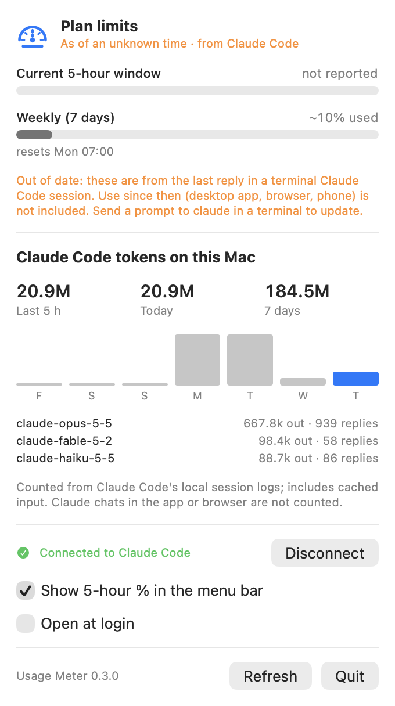

# Usage Meter



**macOS only** (12 Monterey or later, Apple silicon and Intel). A menu-bar gauge for your Claude plan limits and your Claude Code token use.

It uses only what Claude Code itself provides on your Mac: no claude.ai cookies, no private web endpoints, no API calls of its own.

## What it shows

| Section | Source | Notes |
|---|---|---|
| **Plan limits**: 5-hour and weekly % used, reset times | Claude Code's documented status line field `rate_limits` ([docs](https://code.claude.com/docs/en/statusline)) | Pro, Max and Ultra plans. Updated after each reply in a **terminal** Claude Code session; the Claude desktop app and browser do not report it. Numbers are dated by that reply and greyed out after 20 minutes. |
| **Claude Code tokens**: last 5 h, today, 7 days, per model, 7-day chart | Claude Code's session logs in `~/.claude/projects` | Includes cached input, so totals are large. Anthropic calls the log format internal, so this part can break after a Claude Code update. |

The gauge needle in the menu bar follows the 5-hour figure, with the % beside it while it is fresh.

## Install

Needs Xcode or the Command Line Tools (`xcode-select --install`). No other dependencies.

```bash
zsh build.sh install
```

This builds a universal app, copies it to `/Applications` and opens it. Then, in the panel, click **Connect to Claude Code**: it adds a `statusLine` entry to `~/.claude/settings.json` (a backup is kept as `settings.json.bak-usage-meter`). It will not replace a status line you already have.

## Open

- Click the gauge in the menu bar, or
- open **Usage Meter** from Spotlight (⌘ Space), Finder or Launchpad: the panel opens even if the app is already running.
- **Open at login** starts it quietly in the menu bar (macOS 13+).

## How it works

- `UsageMeter --statusline` is the status line command Claude Code runs. It reads Claude Code's JSON from stdin, saves the limits to `~/Library/Application Support/Usage Meter/limits.json` and prints a short line (`Opus · 5h 42% · 7d 71%`). The time of the session's last reply, from its transcript, dates the numbers, so an idle session cannot overwrite fresher ones.
- The app reads that file and the session logs every 30 seconds (only changed log files are re-read).

Other options: `--background` (start without opening the panel), `--screenshot out.png [dark]`, `--set-hook on|off`, `--version`; `UM_HOME=<dir>` redirects the settings and snapshot paths for testing.

## Limits of this approach

- The plan figures are only as fresh as your last terminal Claude Code reply. Usage in the desktop app, browser or phone after that is missing until the next one.
- There is no documented way to read the live figures shown in Claude's settings without your login session, which this app deliberately does not use.

## Uninstall

Click **Disconnect** in the panel, quit the app, and delete `/Applications/Usage Meter.app` and `~/Library/Application Support/Usage Meter`.
